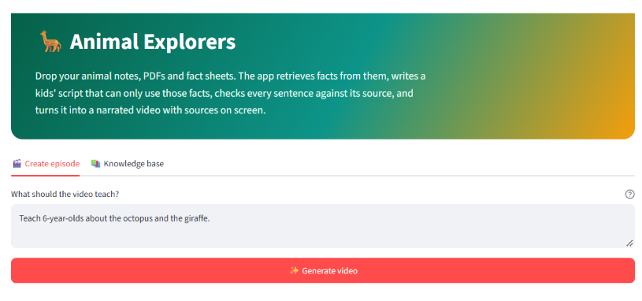
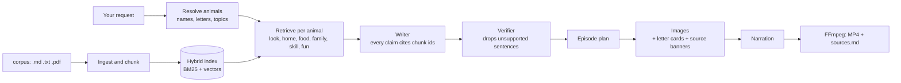

#  Animal Explorers For Kiddies

Turn your own animal notes, PDFs and fact sheets into a narrated kids' video, where every sentence is checked against the document it came from.

Ask for "the octopus and the giraffe", "letter P", "A to Z" or "animals that live in the sea". The app pulls facts from *your* documents, writes a script that is only allowed to use those facts, throws away any sentence its sources don't support, and renders a video with the source printed on every scene.



## Demo
https://github.com/user-attachments/assets/c8dd2490-2914-41a6-b7b3-ae82ea168c62


*This video was generated from the prompt "Teach 6-year-olds about the octopus and the giraffe."*

Some of the scenes from that run:

<table>
  <tr>
    <td></td>
    <td></td>
    <td></td>
  </tr>
</table>

## Why this exists

Ask a language model to write a children's video about giraffes and it will happily make things up. For kids' content that's a real problem, and a quiet one, because the invented facts sound perfectly reasonable.

This project flips the usual setup. The model never gets to answer from memory. It only sees text retrieved from your documents, every claim has to cite the chunk it came from, and a separate verifier checks those citations before anything reaches the video. If your documents don't contain enough to say something true, the app says so instead of filling the gap.

## How it works



1. **Ingest.** Files in `corpus/` are split into chunks along their sections. Optional front matter records the animal, the source and a one-line description of how it looks.
2. **Resolve the request.** Your prompt is turned into a list of animals, whether you named them, asked for a letter or an A to Z run, or described a topic that gets matched against the corpus.
3. **Retrieve.** Each animal gets a balanced evidence pack covering what it looks like, where it lives, what it eats, its family, a special skill and a fun fact. Retrieval is hybrid: BM25 keyword search and vector search, combined with Reciprocal Rank Fusion.
4. **Write.** The writer sees only the retrieved text. Every sentence it produces carries the ids of the chunks that support it. The writer is also allowed to abstain.
5. **Verify.** A verifier checks each sentence against its cited chunks (the citation itself, any numbers, and whether the words are supported) with an optional AI judge as a second layer. Anything unsupported is dropped.
6. **Render.** Each scene gets an image, with a drawn alphabet card for letter requests and the source name burned into the frame. Narration is recorded and FFmpeg assembles the MP4, plus a `sources.md` that lists every citation.

## Setup

**You need**

- Python 3.10 or newer
- [FFmpeg](https://ffmpeg.org/download.html) on your PATH
- An OpenAI API key

**Install**

```bash
git clone https://github.com/Jaycobson/animal-explorers.git
cd animal-explorers

python -m venv .venv
.venv\Scripts\activate          # macOS/Linux: source .venv/bin/activate
pip install -r requirements.txt

copy .env.example .env          # macOS/Linux: cp .env.example .env
```

Put your key in `.env`:

```
OPENAI_API_KEY=your-key-here
```

Open `http://localhost:8501`. The sidebar lets you set the maximum number of animals (1 to 6), facts per animal (1 to 5) and the age group (0-3, 3-5, 5-7 or 7-9).

The **Knowledge base** tab shows what has been indexed, which animals it found and which documents each one came from. You can upload more files there.

The pipeline modules also have offline fallbacks: an extractive writer, free placeholder images and silent narration. The tests and the evaluation harness use these, so they run without a key.

## Adding your own documents

Drop `.md`, `.txt` or `.pdf` files into `corpus/`, or upload them in the app. Front matter is optional:

```
---
animal: Elephant
source: Where this text came from (printed on the video)
url: https://...
look: One line describing how it looks (keeps the pictures consistent)
---
```

Without front matter, the animal name is taken from the file name.

> **A note on the sample files.** The documents included here were written for the demo, not copied from a publisher. Replace them with material you're allowed to use, such as your own notes or public-domain and openly licensed text. Set `source:` and `url:` so the video credits them properly.

## What's in the box

| Feature | Where |
|---|---|
| Hybrid retrieval (BM25 + vectors, Reciprocal Rank Fusion) with an on-disk vector cache | `rag/retriever.py` |
| Request resolver for names, letters, "A to Z" and topic discovery | `rag/request.py` |
| Aspect-based retrieval so each animal gets a balanced set of facts | `rag/writer.py` |
| Writer limited to retrieved text, with chunk-id citations | `rag/writer.py` |
| Verifier that drops unsupported sentences, and a writer that can abstain | `rag/verifier.py` |
| Visual bible and per-animal look for consistent pictures | `rag/bible.py`, `pipeline/explorer.py` |
| Source banner on every frame, and a `sources.md` file | `pipeline/cards.py`, `pipeline/explorer.py` |
| Evaluation harness for retrieval and the verifier | `eval/` |

The finished episode shows how many scenes were made, what share of the script was verified against sources, and how long it took. You can download the MP4, or a ZIP with the images, audio, `sources.md` and `plan.json`.

## Results

Measured with the offline embedder on 37 chunks across 8 animals:

| | recall@3 (direct questions) | recall@3 (paraphrased questions) |
|---|---|---|
| BM25 | 1.00 | 0.90 |
| Vector (offline hash embedder) | 0.90 | 0.50 |
| Hybrid (RRF) | 1.00 | 0.90 |

Verifier probe: 91 of 91 true sentences accepted, 22 of 23 wrong-number sentences caught, 91 of 91 wrong-source claims caught.

**Read these numbers with some suspicion.**

- The test questions were written by the same person who wrote the documents, which flatters keyword search.
- The offline "vector" embedder is lexical, so it isn't a fair test of dense retrieval. That's why hybrid doesn't beat BM25 here.
- For a real comparison, run `python -m eval.run --openai`.
- The one wrong-number miss happens when the swapped number also appears elsewhere in the same chunk. The optional AI judge is the second layer for that case.
- The verifier is deliberately strict. It can drop a correct sentence if it's heavily reworded or involves arithmetic.

Run the evaluation with:

```bash
python -m eval.run
```

## Project layout

```
.
├── app.py              # Streamlit interface
├── rag/
│   ├── ingest.py       # reads and chunks documents
│   ├── retriever.py    # hybrid index
│   ├── request.py      # resolves names, letters and topics
│   ├── episode.py      # plans an episode
│   ├── writer.py       # LLM and offline writers
│   ├── verifier.py     # citation and fact checks
│   └── bible.py        # visual style and per-animal looks
├── pipeline/           # images, cards, narration, FFmpeg
├── corpus/             # your documents
├── bible/              # visual bible files
├── samples/            # sample material
├── eval/               # retrieval and verifier evaluation
├── tests/              # pytest suite
├── workflows/          # ComfyUI workflows
└── requirements.txt
```

Run the tests with `pytest`.

